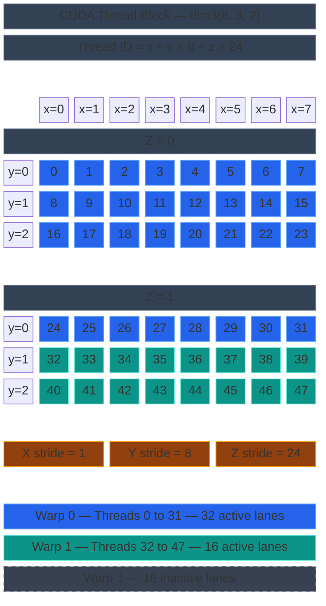

## 2.3 Writing SIMT Kernels

### 2.3.1. Basics of SIMT
CUDA thread is the fundamental unit of parallelism. The SIMT moidel allows each thread to maintain its own state and control flow. From a functional prespective, each thread can execute a seperate code path. Substantial performance improvments can be realized by minimizing situations where threads in the same wrap take divergent code paths.

### 2.3.2. Thread Hierarchy
Threads are organized into thread blocks (TB) which are then organized into grid. Both can be 1, 2 or 3 dimensional. The builtin variables are used to compute a global unique thread index enabling each thread to load/store specifi cdat afrom global memory and execute a unique code path as needed.

* `gridDim.[x|y|z]`: Size of the grid in the `x`,`y` and `z` dimension respectively. These values are the same for all threads and are part of the execution configuration set at kernel launch.
* `blockDim.[x|y|z]`: Size of the block in the`x`,`y` and `z` dimension respectively. These values are the same for all threads and are part of the execution configuration set at kernel launch.
* `blockIdx.[x|y|z]`: Index of the block in the`x`,`y` and `z`dimension respectively. These values will differ among threads, to indicate which thread block is executing.
* `threadIdx.[x|y|z]`: Index of the thread in the `x`,`y` and `z` dimension respectively. These values will differ among threads, to indicate which thread is executing.

The use of multi-dimensional thread blocks and grids is for convience only and doesn't affect performance. The threads of a block are linearized predictably: the first index `x` moves the fastest, followed by `y` and then `z`.  Consecutive values of `threadIdx.x` indicate consecutive threads, `threadIdx.y` has a stride of `blockDim.x`, and `threadIdx.z` has a stride of `blockDim.x * blockDim.y.` This affects how threads are assigned to warps, as detailed in [Hardware Multithreading](https://docs.nvidia.com/cuda/cuda-programming-guide/03-advanced/advanced-kernel-programming.html#advanced-kernels-hardware-implementation-hardware-multithreading).


| Dimension     | Linear ID stride          |
|---------------|---------------------------|
| `threadIdx.x` | 1                         |
| `threadIdx.y` | `blockDim.x`              |
| `threadIdx.z` | `blockDim.x * blockDim.y` |

$$
\boxed{\text{WarpID} = \left\lfloor \frac{\text{ThreadID}}{32} \right\rfloor}
$$

$$
\boxed{\text{LaneID} = \text{ThreadID} \bmod 32}
$$

#### 2.3.2.1. Thread Block Synchronization
When threads within a TB cooperate or access the same memory address, especially in shared memory synchronization is necessary to avoid race conditions and memory hazards. The most basic form of sync within a block is called `__syncthreads`

### 2.3.3. GPU Device Memory Spaces

| Memory Type | Scope  | Lifetime    | Location |
|-------------|--------|-------------|----------|
| Global      | Grid   | Application | Device   |
| Constant    | Grid   | Application | Device   |
| Shared      | Block  | Kernel      | SM       |
| Local       | Thread | Kernel      | Device   |
| Register    | Thread | Kernel      | SM       |

**Table 1** memory types scopes and life times

#### 2.3.3.1. Global Memory
Global memory (also called device memory) is the primary memory space for storing data that is accessible by all threads in a kernel (similar to RAM in a CPU system). Kernels running on the GPU have direct access to global memory in the same way code running on the CPu has access to system memory.

Global memory is persistant: an allocation made in global memory and the data stored in it persist until the allocation is freed or app is terminated. `cudaDeviceReset` also frees all allocations.

Global memory is allocated with `cudaMalloc` and `cudaMallocManaged`. Data copied to global memory from CPU using CUDA runtime API such as `cudaMemcpy` and freed using `cudaFree`.

Before kernel launch globial memory is allocated and init by CUDA API calls. During kernel execution, it can be read by the CUDA threads and the result from operations can be written back to global memory. Once kernel has completed execution, the result written back to global memory can be copied back to the host or used by other kernels on the GPU.

Global memory is accessible by all threads in a grid and care must be taken to avoid data races between threads. Since CUDA kernels launched from the host have return type `void`, the only way for numerical results to be returned to the host is by writing those back to global memory. 

`A`, `B` and `C` are in global memory:
```cpp

__global__ void vecAdd(float* A, float* B, float* C, int vectorLength)
{
    int workIndex = threadIdx.x + blockIdx.x*blockDim.x;
    if(workIndex < vectorLength)
    {
        C[workIndex] = A[workIndex] + B[workIndex];
    }
}
```

#### 2.3.3.2. Shared Memory
Shared memory is a memory space accessible by all threads in a thread block (TB) physically located on each SM and uses the same physical resource as L1 cache, the unified data cache. Data in shared memory presists throughout the kernel execution. It can be considered as a user-managed scratchpad for use during kernel execution. Despite being small in size the bandwidth is higher and the latency is lower than accessing global memory.

Since shared memory is accessible by all threads in a TB, care must be taken to avoid data races between threads in the same TB. Synchronization between threads in the same TB can be achieved using the `__syncthreads()` function in C++ which blocks all threads in the TB until all threads have reached the call to `__syncthreads()``.

```cpp

// assuming blockDim.x is 128
__global__ void example_syncthreads(int* input_data, int* output_data) 
{
    __shared__ int shared_data[128];
    shared_data[threadIdx.x] = input_data[blockDim.x*blockIdx.x + threadIdx.x];

    // All threads synchronize, guaranteeing all writes to 'shared_data' are ordered 
    // before any thread is unblocked from '__syncthreads()':
    __syncthreads();

    // A single thread safely reads 'shared_data':
    if (threadIdx.x == 0) {
        float sum = 0;
        for (int i = 0; i < blockDim.x; ++i) {
            sum += shared_data[i];
        }
        output_data[blockIdx.x] = sum;
    }
}
```

Size of shmem (shared memory) varies depending on the architecture. Using shmem reduces the size of the usable L1 cache (as they share the same space). If no shmem is used, the entire physical space will be utilized by L1 cache. 

To query shmem size per SM and per TB, we can use `cudaGetDeviceProperties` and investigating the `cudaDeviceProp.sharedMemPerMultiprocessor` and `cudaDeviceProp.sharedMemPerBlock` device properties.

CUDA runtime API provides a function `cudaFuncSetCacheConfig ` to allocate more space to shmem or L1 cache, it specifies a preference to the runtime but is not guranteed to be honored.  The runtime is free to make decisions based on the available resources and the needs of the kernel.

Shared memory can be allocated both statically and dynamically.

##### 2.3.3.2.1. Static Allocation of Shared Memory
To allocate shmem statically, the variable must be declared using `__shared__`. The array will persist for the duration of the kernel execution. 
```cpp
__shared__ float sharedArray[1024];
```

#### 2.3.3.2.2. Dynamic Allocation of Shared Memory
To allocate shmem dynamically in C++, the programmer can specify the desired amount of shmem per TB in bytes as the third (and optional) argument to the `<<<grid, block, shmemBytes>>>` when not specified, it defaults to 0.

Inside the kernal, we can use the `extern __shared__` specifier wwith empty `[]` in C++ to declare a variable that will be allocated dynamically at kernel launch.
```cpp
extern __shared__ float sharedArray[];
```

One caveat is that kernal can have onle 1 dynamically allocated shared array. If multiple dynamically allocated shared memory arrays, a single dynamically allocated shmem array which is large enough to contain all the desired array must be allocated and manually partioned. In C++ if we want the equivalent of the following: 
```cpp
short array0[128];
float array1[64];
int   array2[256];
```
In dynamically allocated shmem, one could do the following:
```cpp
extern __shared__ float array[];

short* array0 = (short*)array;
float* array1 = (float*)&array0[128];
int*   array2 = (int*)&array1[64];
```

Pointers need to be aligned to the type they point to so the following example doesn't work as `array1` is not aligned to 4 bytes:
```cpp
extern __shared__ float array[];
short* array0 = (short*)array;
float* array1 = (float*)&array0[127];
```

#### 2.3.3.3. Registers
Registers are located ont he SM and have thread local scope. Register usage is managed by the compile rand registers are used for thread local storage during the xecution of a kernel. The numbe rof registers per SM and per TB can be queried using the `regsPerMultiprocessor ` and `regsPerBlock` device properties of the GPU.

NVCC allows the developer to [specify a maximum numbe rof registers](https://docs.nvidia.com/cuda/cuda-compiler-driver-nvcc/index.html#maxrregcount-amount-maxrregcount) to be used by the kernal via the `-maxrregcount` option. Using this option to reduce the number of registers a kernel can use may result in more TB being scheduled on the SM concurrently but may also result in more register spilling (values currently stored on chip in registers must be written out to global memory and then read back later to make space for other values).

#### 2.3.3.4. Local Memory
Local memory is thread local storage similar to registers and managed by NVCC but the physical location of it is in global memory space. The 'local' label refers to its logical scope not its physical location. Local memory is used for thread local storage during the execution of a kernel. Automatic vars that the compiler is likely to place in local memory are:
* Arrays for which it cannot determine that they are indexed with constant quantities
* Large structures or arrays that would consume too much register space,
* Any variable if the kernel uses more registers than available, that is register spilling.

Since local memory space resides in device memory it has the same latency and bandwidth as global memory accesses and are subject to the same requirements for memory coalescing. However, local memory is organized such that consecutive 32bit words are accessed by consecutive thread IDs. Accessess are therefore fully coalesced as long as the threads in the warp access the same relative address (such as the same index in an array variable or the same member in a structure variable).

#### 2.3.3.5. Constant Memory
Constant memory has grid scope and is accessible for the lifetime of the app, it resides on the device and is read-only to the kernel.

In C++, vars or arrays declared with `__constant__` specifier outside any kernel or function.

Constant memory means that a variable:
* Resides in constant memory space,
* Has a distinct object per device,
* Is accessible from all threads within the grid and from the host in C++ through the runtime library (`cudaGetSymbolAddress()` / `cudaGetSymbolSize()` / `cudaMemcpyToSymbol()` / `cudaMemcpyFromSymbol()`)

In C++, constant memory has the lifetime of the ctx in which it was created. In Python it has lifetime of the kernel which it is declared. 

The total amount of constant memory can be queried with the `totalConstMem` device property element.

Constant memory is useful for small amounts of data that each thread will use in read-only fashion. It is small relative to other memories (64KB per device).

```cpp
// In your .cu file
__constant__ float coeffs[4];

__global__ void compute(float *out) {
    int idx = threadIdx.x;
    out[idx] = coeffs[0] * idx + coeffs[1];
}

// In your host code
float h_coeffs[4] = {1.0f, 2.0f, 3.0f, 4.0f};
cudaMemcpyToSymbol(coeffs, h_coeffs, sizeof(h_coeffs));
compute<<<1, 10>>>(device_out);
```

#### 2.3.3.6. Caches
GPU have a multi-level cache structure which includes L2 and L1 caches.

L2 is located on device and is shared among all SM, its size can be queried using `l2CacheSize` using the function `cudaGetDeviceProperties``.

L1 cache is physically located one ach SM and is the same physical space used by shared memory. If no shmem is utilized by the kernel, the entire physical space will be utilized by the L1 cache.

The L2 and L1 cache can be controlled via functions that allow the specification of the caching behviors. The details can be found in [Configuring L1/Shared Memory Balance](https://docs.nvidia.com/cuda/cuda-programming-guide/03-advanced/advanced-kernel-programming.html#advanced-kernel-l1-shared-config), [L2 Cache Control](https://docs.nvidia.com/cuda/cuda-programming-guide/04-special-topics/l2-cache-control.html#advanced-kernels-l2-control),  [Low-Level Load and Store Functions](https://docs.nvidia.com/cuda/cuda-programming-guide/05-appendices/cpp-language-extensions.html#low-level-load-store-functions).

If these hints are not used the compiler and runtime will do their best to utilize the caches efficiently.

#### 2.3.3.7. Texture and Surface Memory
A GPU may have specialized instructions for loading data from an image to be used as textures in 3D rendering. CUDA exposes those instruction in [texture object API](https://docs.nvidia.com/cuda/cuda-runtime-api/group__CUDART__TEXTURE__OBJECT.html) and [surface object API](https://docs.nvidia.com/cuda/cuda-runtime-api/group__CUDART__SURFACE__OBJECT.html).

Texture and surface memory do not provide any performance advantage for non graphics apps in CUDA. These APIs are still useful when reading texture or surface data for rendering such as writing hit shardres for [NVIDIA OptiX](https://developer.nvidia.com/rtx/ray-tracing/optix).

If working on existing code bases which still use these APIs for non texture loads, explanatio can be found in legacy [CUDA C++ Programming Guide](https://docs.nvidia.com/cuda/archive/13.0.0/cuda-c-programming-guide/index.html#texture-and-surface-memory).

#### 2.3.3.8. Distributed Shared Memory

